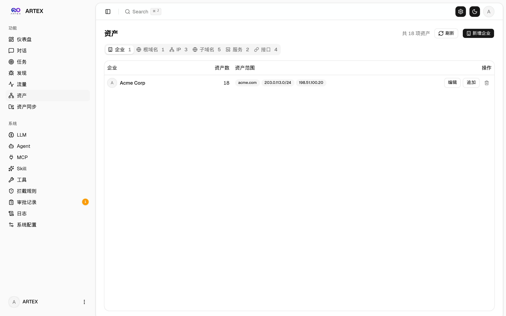
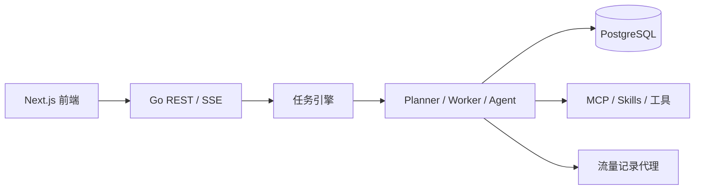

<div align="center">

# ARTEX 中文版

面向已获授权安全测试与本地研究的 AI 多 Agent 安全测试平台。

Go 后端 · Next.js 前端 · PostgreSQL · 可选 REA 逆向分析模式

[中文](README.md) · [English](README.en.md) · [中文完整文档](README.zh.md)

[](LICENSE)
[](https://github.com/azrielnan/artex-ko-main/actions/workflows/ci.yml)

</div>

## 项目简介

ARTEX 将任务编排、资产管理、探索图、流量记录、人工审批、漏洞发现和报告整合到一个 Web 平台中。Go 单体后端可以把 Next.js 静态前端嵌入单个二进制，数据使用 PostgreSQL 持久化，Agent 通过 `norma` SDK 调用工具并记录可追溯证据。

项目提供两种相互隔离的对话模式：

- **安全测试**：用于已授权范围内的资产发现、验证、复测和报告整理。
- **逆向分析**：通过可选的 [REA](https://github.com/morluto/rea) MCP 分析本地程序、软件包、源码树和运行时材料。

模式分别保存会话、提示词和 Agent 上下文，不会混用另一模式的对话、任务、资产、流量或发现。

## 在线 Demo

[打开 ARTEX 中文 Demo](https://azrielnan.github.io/artex-ko-main/)

Demo 使用明确标注的模拟数据，不连接真实目标，也不会读取你的 API Key。项目仓库和发布包入口：

- [GitHub 仓库](https://github.com/azrielnan/artex-ko-main)
- [Releases](https://github.com/azrielnan/artex-ko-main/releases)

## 截图预览

| 仪表盘 | 任务列表 |
| :---: | :---: |
|  |  |

| 执行过程 | 探索链路 |
| :---: | :---: |
|  |  |

| 发现 | 资产 |
| :---: | :---: |
|  |  |

| 资产覆盖图 | 流量与人在环路对话 |
| :---: | :---: |
|  |  |

| 对话 | Agent 与 LLM 配置 |
| :---: | :---: |
|  |  |

> 截图来自本地隔离环境中的演示数据，仅用于展示界面布局和交互流程。

## 快速开始

### 方式一：安装脚本

依赖 Docker 或本机 Go、Node.js 和 PostgreSQL。安装脚本会检测环境，并引导你选择 Docker 或本地编译运行：

```bash
git clone https://github.com/azrielnan/artex-ko-main.git
cd artex-ko-main
./install.sh
```

启动后访问 <http://localhost:8787>，首次进入 `/setup` 设置管理员密码。

### 方式二：Docker Compose

```bash
git clone https://github.com/azrielnan/artex-ko-main.git
cd artex-ko-main
cp .env.example .env
# 编辑 .env，至少设置 POSTGRES_PASSWORD
docker compose up -d
```

容器会持久化 `data/`、`skills/` 和 PostgreSQL 数据卷。LLM 可通过环境变量或系统设置页面配置。

> 当前 Compose 配置使用上游 `autumn27/artex` 镜像；它可能不包含本仓库最新源码中的前端和后端改动。要使用包括 REA 模式在内的最新功能，请按下方步骤从源码构建，或下载包含相应改动的 Release。

> 当前 Compose 配置使用上游 `autumn27/artex` 镜像；它可能不包含本仓库最新源码中的前端和后端改动。要使用包括 REA 模式在内的最新功能，请按下方步骤从源码构建，或下载包含相应改动的 Release。

### 方式三：下载 Release

从 [Releases](https://github.com/azrielnan/artex-ko-main/releases) 下载对应平台的压缩包，复制示例配置后启动：

```bash
cp config.example.json config.json
./start.sh                 # Windows 使用 start.bat
```

请使用 `start.sh` 或 `start.bat` 启动，它负责更新后的重新拉起和失败回滚；不要直接运行二进制代替守护脚本。

### 方式四：从源码构建

```bash
cd web
npm ci
npm run build:static
cd ..
rm -rf server/webui/dist
mkdir -p server/webui/dist
cp -a web/out/. server/webui/dist/
CGO_ENABLED=0 go build -tags embedui -o artex ./cmd/artex
./start.sh
```

构建跨平台发布包：

```bash
./build.sh --release
```

## 配置

### 数据库

复制 `config.example.json` 为 `config.json`，填写 PostgreSQL 连接；也可以使用 `ARTEX_PG_DSN` 覆盖配置。

### LLM

可以在系统设置页面填写供应商、模型、Base URL 和 API Key，也可以通过环境变量配置：

```bash
export ANTHROPIC_API_KEY=<your-key>
# 或：export OPENAI_API_KEY=<your-key>
```

本仓库不包含任何真实 API Key、密码或私有连接信息。请勿把 `config.json`、`.env`、`data/` 或运行日志提交到 Git。

### REA 逆向分析模式

逆向模式默认关闭，不会在启动 ARTEX 时自动下载或运行第三方分析器。启用步骤：

1. 安装 Node.js **22.19+、24.11+ 或 26+**。
2. 在「系统设置 → MCP」中启用预置的 `REA` 服务。GitHub Release 分发包优先使用包内 Node.js/REA 运行时；源码环境没有内置运行时时才回退到 `npx -y rea-agents@6.5.0 mcp`。
3. 按 [REA 中文文档](https://github.com/morluto/rea/blob/main/docs/readme/README_zh.md) 配置具体分析器及其依赖。
4. 在聊天页切换到「逆向分析」，上传或指定本地材料后开始分析。

内置技能说明见 [`skills/rea-reverse-engineering/SKILL.md`](skills/rea-reverse-engineering/SKILL.md)。REA 及其分析器是第三方软件，不随 ARTEX 重新分发，请以其上游许可证和版本说明为准。

## 主要能力

| 能力 | 说明 |
| --- | --- |
| 任务编排 | Planner、Worker 和人工介入协同推进任务，支持暂停、恢复和审批 |
| 资产与探索图 | 维护全局资产事实与按任务隔离的探索链路，保留来源和证据 |
| 流量记录 | 通过记录型代理保存请求、响应和活动轨迹 |
| 漏洞复测 | 为漏洞创建独立复测会话，保存结论、证据和历史记录 |
| MCP 与技能 | 支持远程 MCP、内置技能和 REA 逆向分析技能 |
| 更新与发布 | 支持页面更新、脚本更新和跨平台 Release 压缩包 |

## 本地开发与测试

```bash
./dev.sh                         # 后端 8787、代理 8788、前端 5173
go test ./... -p 1 -parallel 1   # 后端测试
cd web && npm run dev            # 前端热更新
```

仅查看界面时可以使用模拟数据：

```bash
cd web
NEXT_PUBLIC_MOCK=1 npm run dev
```

更完整的安装、更新、反向代理、架构和复测说明见 [`README.zh.md`](README.zh.md)。

## 架构概览



前端通过同源 REST 和 SSE 访问 Go 后端；任务引擎调度 Agent，将资产、探索节点、活动、发现和证据写入 PostgreSQL。安全测试与逆向分析在会话模式字段、API 查询、数据库记录和前端历史列表层面保持隔离。

## 许可与免责声明

本项目采用 [GNU Affero General Public License v3.0](LICENSE)。使用者必须只在自己拥有或已取得明确书面授权的环境中运行安全测试功能，并自行遵守所在地关于网络安全、数据安全、个人信息和计算机犯罪的法律法规。

在中国大陆，使用者应特别遵守《网络安全法》《数据安全法》《个人信息保护法》及相关司法解释；未经授权访问、扫描、探测、利用或破坏他人系统可能承担民事、行政或刑事责任。

本项目按“现状”（AS IS）提供，不对适用性、准确性、可用性或不间断运行作任何明示或默示保证。因使用、修改、部署或分发本项目造成的损失、数据泄露、系统损坏或法律后果，由使用者自行承担。下载、安装或使用本项目，即表示你已阅读并同意 [LICENSE](LICENSE) 及本免责声明。
